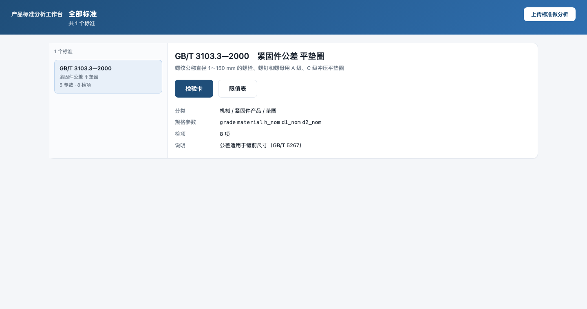
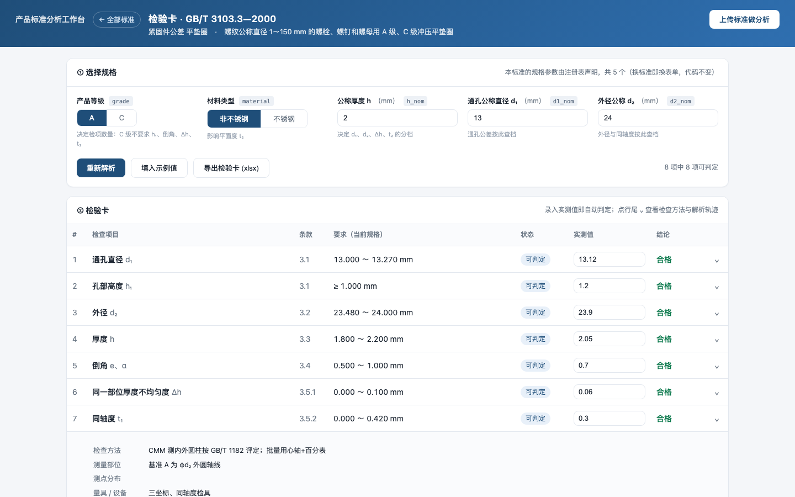
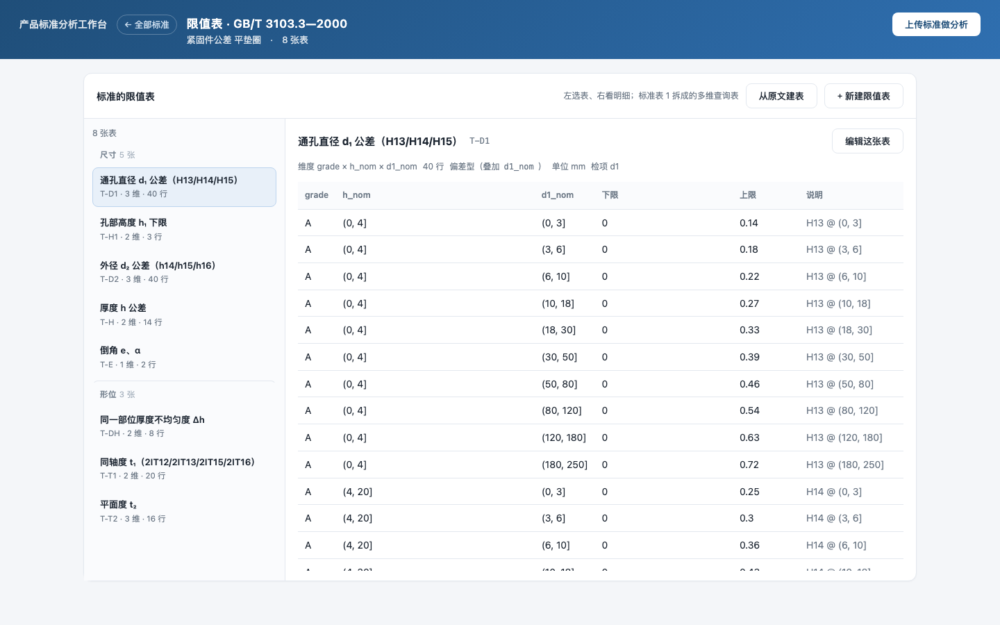

# 产品标准分析工作台

把一份产品标准 PDF，变成**能直接用的检验卡**：识别检项、建限值表、选规格出卡、录实测判定。

面向紧固件/机械类产品标准（当前样例为 GB/T 3103.3—2000 平垫圈），
核心不是"读懂标准"，而是**把标准里的限值变成可计算的规则**。

## 界面

打开 <http://127.0.0.1:8022> 是**标准列表**：左边是已分析的标准，选中后右边出现
「检验卡」「限值表」两个入口；右上角固定是「上传标准做分析」。



| 页面 | 路由 | 做什么 |
|---|---|---|
| 全部标准 | `#/standards` | 选标准，进检验卡或限值表 |
| 检验卡 | `#/card/<标准>` | 选规格 → 出卡 → 录实测 → 判定（`?demo=1` 带示例值） |
| 限值表 | `#/tables/<标准>` | 左选表、右看明细，可编辑、可从原文建表 |
| 上传分析 | `#/analyze` | 上传 PDF → 识别检项与表格 → 确认 → 发布成标准 |





## 快速开始

```bash
git clone <repo> && cd Standard_analyze

python3 -m venv .venv
.venv/bin/pip install -r g1/service/requirements.txt

./g1/service/run.sh            # 默认 http://127.0.0.1:8022
```

首次启动会自动：建库、灌入 GB/T 3103.3 的 8 张限值表（143 行）、编译离线 OCR 组件（macOS）。

- `#/card` —— 按标准出检验卡（加 `?demo=1` 带示例实测值）
- `#/analyze` —— 上传标准做分析
- `#/tables` —— 限值表浏览与编辑

## 它解决什么问题

标准的限值很少是"一个数"。GB/T 3103.3 里随手能拎出四种写法：

| 标准写法 | 它是什么 | 系统怎么存 |
|---|---|---|
| `±0.2` | 常量 | 数值 |
| `H13` | 代号，要查 GB/T 1800 | 展开成偏差，按公称尺寸叠加 |
| `0.5h` | 公式 | 表达式 `0.5*h_nom` |
| `2IT12` | 代号 × 系数 × 尺寸档 | 多维度限值行 |

所以限值表是**多维查询表**（维度 × 展开行 × 限值），表头带"偏差型/绝对值"，
判定时先按参数命中行，再算绝对值。详见 [spec.md](spec.md)。

## 数据结构

4 张表：`standard`（标准 + 参数 + 检项）、`limit_table`（限值表头）、
`limit_dim`（维度）、`limit_row`（限值行）。
完整字段、DDL、JSON 结构与示例见 **[docs/schema.md](docs/schema.md)**。


## 目录

```
g1/
  limit_engine.py        限值解析引擎（四类值 / 三态 / 偏差 / 基准参数 / 安全表达式）
  gb3103_3.py            标准的 8 张限值表 + 28 项断言
  service/
    app.py               FastAPI 路由
    db.py                SQLite：standard / limit_table / limit_dim / limit_row
    standards.py         标准注册表
    extract_doc.py       PDF → 文本（ocrkit 离线 OCR）
    tablefind.py         从 OCR 词框还原表格网格
    analyze.py           条款切分 + 检项识别 + 参数建议
    jobs.py              分析作业
    card.py / card_std.py 检验卡导出
    templates/index.html 单页界面
    tools/load_gb3103.py 灌数据
  docs/                  界面截图
```

## 清空数据

```bash
.venv/bin/python g1/service/tools/reset_db.py --jobs   # 标准/限值表/作业/上传件全清，保留表结构
.venv/bin/python g1/service/tools/load_gb3103.py       # 想要回样例标准
```

> 直接删 `data/app.db` 会让 `run.sh` 下次启动时重新灌样例。

## 测试

```bash
.venv/bin/python g1/gb3103_3.py                  # 28 项 引擎
.venv/bin/python g1/service/test_parse.py        # 15 项 限值单元格解析
.venv/bin/python g1/service/test_limits.py       # 12 项 限值形态
.venv/bin/python g1/service/test_generic.py      # 22 项 换标准不改代码
.venv/bin/python g1/service/test_api.py          # 42 项 HTTP（含隔离与编辑往返）
.venv/bin/python g1/service/test_analyze.py      # 39 项 全链路（需样例 PDF）
```

## 已知限制

- **限值由人确认**：OCR 只负责"有哪些检项、表格长什么样"，数值与代号要人核对。
- **不支持跨标准共享限值表**：表属于单个标准，同名不冲突，但一套表不能给多个标准用。
- **只支持 PDF**；OCR 依赖 macOS Vision（Linux 上需另配 OCR）。
- **符号表（IT 值/公差带）还没入库**，目前写在 `load_gb3103.py` 里。

## 技术栈

Python 3.12 · FastAPI · SQLite · 原生 JS 单页（无构建）· macOS Vision OCR（Swift）
