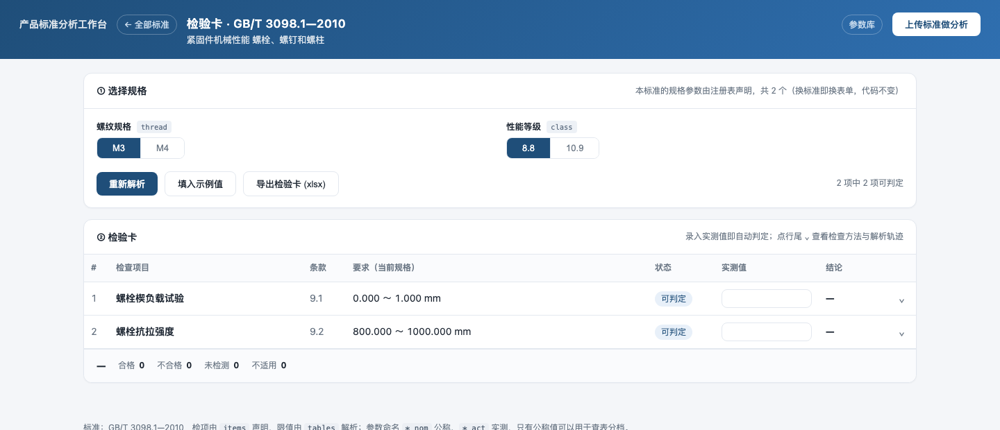
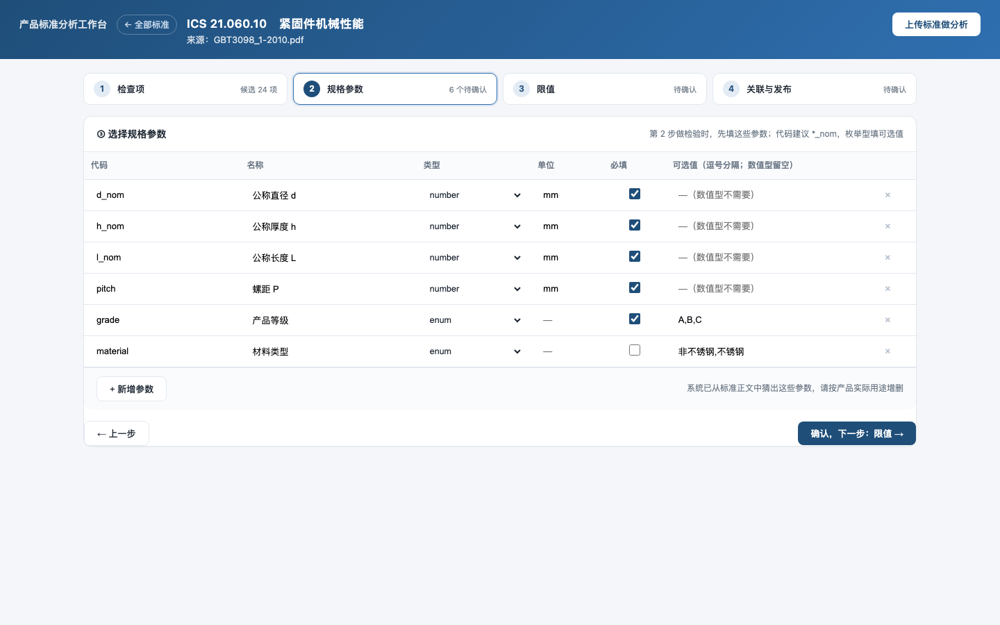
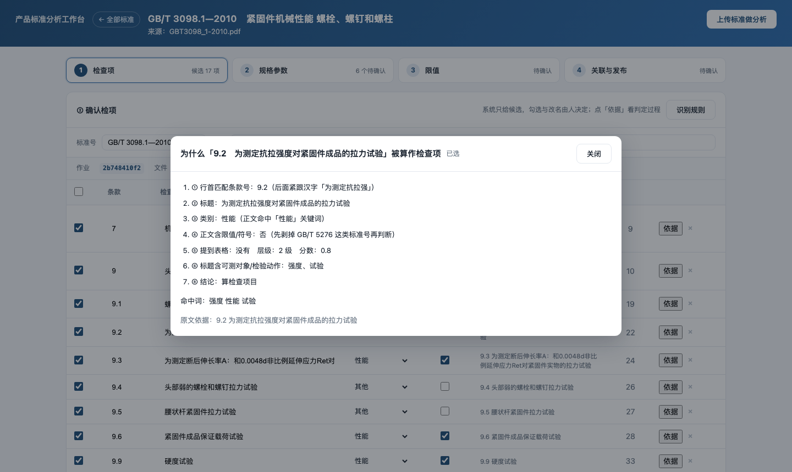
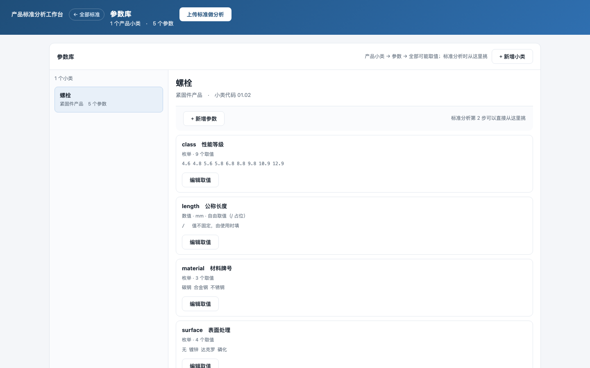
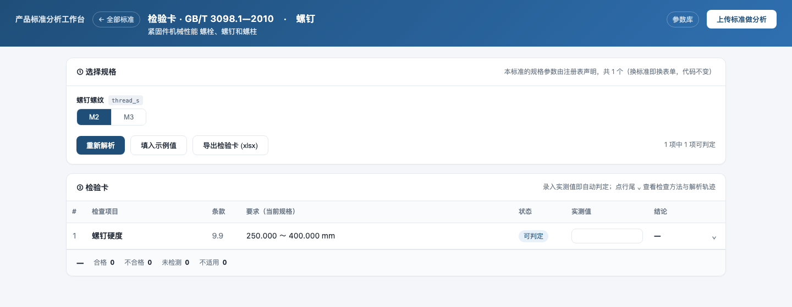
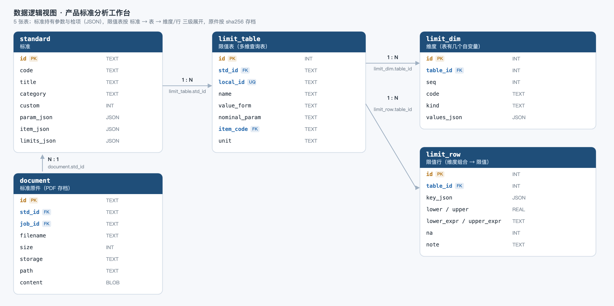

# 产品标准分析工作台

把一份产品标准 PDF，变成**能直接用的检验卡**：识别检项 → 定参数 → 建限值表 → 选规格出卡 → 录实测判定。

面向紧固件 / 机械类产品标准。核心不是"读懂标准"，而是**把标准里的限值变成可计算的规则**，
并且让"参数、参数值、限值"这些资产按**产品小类**沉淀下来，跨标准复用。


## 三件事

| 事 | 在哪 | 产出 |
|---|---|---|
| 标准分析 | 上传 PDF → 四步确认 | 一份可分层的标准（参数 / 检项 / 限值） |
| 复合大表拆解 | 限值表管理 → 录入复合大表 | 自动按 No. 拆解单指标多维子表并联动检项 |
| 出检验卡 | 选标准与小类 → 填规格 | 逐项限值 + 公称基准 + 实测判定 |
| 参数库 | 按产品小类维护 | 参数名称表 + 参数值表（跨标准复用） |

## 界面

打开 <http://127.0.0.1:8022> 是**标准列表**：左边已分析的标准，选中后右边出现
「检验卡」「限值表」；多小类的标准会按小类分别给出入口。右上角是「上传标准做分析」，
再往左是「参数库」。

| 页面 | 路由 | 做什么 |
|---|---|---|
| 全部标准 | `#/standards[/<标准>]` | 选标准，进检验卡或限值表 |
| 检验卡 | `#/card/<标准>[?sc=<层>]` | 选规格 → 出卡 → 录实测 → 判定 |
| 限值表 | `#/tables/<标准>[?sc=<层>]` | 左选表、右看明细，可编辑、可从原文建表、可录入复合大表 |
| 上传分析 | `#/analyze[/<作业>[/<1-4>]]` | 上传 PDF → 四步确认 → 发布 |
| 参数库 | `#/catalog[/<小类>]` | 小类 | 参数名称表 | 参数值表 |




## 复合大表拆解与多维限值生成（按 No. 逐项向导）

国标中（如 GB/T 3098.1 表3 机械性能、表4 最小拉力载荷）大量存在复合大表。系统提炼出**拓扑三层解构模型 (USMP 通用标准矩阵协议)**：

1. **Layer 1：表头公共参数池 (`common_dims`)**：整张母表全局自变量（如：性能等级 `property_class`、公称直径 `d_nom`），所有主表默认自动继承；
2. **Layer 2：按 No. 序号展开的限值主表清单 (`tables`)**：每一个 No.（如 No. 1 抗拉强度、No. 2 屈服强度、No. 5 保证应力）独立作为一张单指标限值主表实体；
3. **Layer 3：专属增量参数确认 (`extra_dims`)**：由人工在界面确认该 No. 是否需要额外参数（如为 No. 1 抗拉强度加入 `公称抗拉强度 rm_nom`，为其他项确认是否需要专属参数）；
4. **明细展开与切分编译**：展开该主表后呈现多维明细网格，点击【保存并自动切分编译】，系统自动将每笔主表存入数据库（`limit_table`、`limit_dim`、`limit_row`），并与检验项自动联动！

详见架构规范：**[docs/universal_matrix_abstraction.md](docs/universal_matrix_abstraction.md)** 与协议定义 **[g1/matrix_protocol.py](g1/matrix_protocol.py)**。

## 标准分析：四步

一份复杂标准（几百条条款、几十张表）不可能一步确认完，所以拆成四步，**每步单独保存**，
关掉浏览器回来还能接着做。

| 步 | 系统给什么 | 人做什么 |
|---|---|---|
| ① 检查项 | 条款候选 + 页码 + 原文依据 + 判定理由 | 勾掉误检，补回漏检 |
| ② 规格参数 | 从正文猜出的参数，可改可加 | 从参数库挑，或手工补 |
| ③ 限值 | 每项一格 + 可导入原文表格 | 填数 / 填表达式 / 建多维表 / 录入复合母表 |
| ④ 关联与发布 | 检项 × 限值来源的矩阵 | 决定查表还是手填，然后发布 |



**候选会先过滤一轮**。GB/T 3098.1（48 页）实测：158 条候选 → 17 条，被过滤的每条都能看到原因
（章节标题 / 过程性小节 / 性能等级写法 / 表格单元格 / 无可测对象），点「依据」能看到逐步判定过程。



## 参数库（产品小类 → 参数 → 取值）

标准之上还有一层"最大集"：产品小类下挂着这类产品可能用到的全部参数，每个参数挂它的全部取值。



- 参数名称表和参数值表是**两张全局表**，小类通过关联表引用；同一参数被多个小类用时共用一份取值
- 数值型参数无法枚举，用 **`/` 占位**表示"有这个参数、值不固定"
- 分析标准时「从参数库导入」，勾选参数，取值一起带进标准

## 一份标准多个小类

同一份标准常常横跨多个小类（GB/T 3098.1 就是螺栓 / 螺钉 / 螺柱）。库里用
`standard_class`（标准 × 小类）承接，**每行只挂一个小类**，行下各有自己的参数、检项、限值、限值表。



界面按层切换：同一份标准，`?sc=` 不同，看到的规格参数和检项就不同。

## 快速开始

```bash
git clone <repo> && cd Standard_analyze

python3 -m venv .venv
.venv/bin/pip install -r g1/service/requirements.txt

./g1/service/run.sh            # 默认 http://127.0.0.1:8022
```

首次启动会自动：建库、灌入 GB/T 3103.3 平垫圈作为样例、编译离线 OCR 组件（macOS）。

## 数据结构

核心数据表：

```
standard ──┬── standard_class（标准 × 小类）──┬── param_json / item_json / limits_json
           │                                  └── limit_table.sc_id
           ├── limit_matrix（复合大表母表）
           ├── limit_table ── limit_dim
           │                └── limit_row
           └── document ←→ standard_document（原件，多对多）

product_class ── class_param ── param_name ── param_value（参数库）
```

完整字段、DDL、JSON 结构与示例见 **[docs/schema.md](docs/schema.md)**。



## 导出

```bash
# 把一份标准的完整数据导成 Excel（概况/参数/检项/限值表/维度/限值行 六个工作表）
.venv/bin/python g1/service/tools/export_standard.py gb3103-3 输出.xlsx
```

## 数据清空与重置

```bash
# 1. 一键清空除参数库外的所有业务数据（标准、限值表、矩阵、原件、作业缓存）并重启服务
./clean_data.sh --restart

# 2. 预览模式（只查看将清掉什么，不动手）
./clean_data.sh --dry-run

# 3. 想要回 GB/T 3103.3 样例标准
.venv/bin/python g1/service/tools/load_gb3103.py
```

## 目录

```
g1/
  limit_engine.py        限值求值引擎（常量/表达式/规则/多维表/公称基准透传）
  matrix_protocol.py     USMP 通用标准矩阵协议与强类型数据类
  gb3103_3.py            GB/T 3103.3 的表与断言（引擎自测）
  service/
    app.py               FastAPI 路由（含复合大表母表 API）
    db.py                SQLite：标准、层、复合大表母表、限值表、原件、参数库
    standards.py         Standard / Layer / Param 模型与校验
    analyze.py           条款切分、检项判定、参数建议、规则目录
    extract_doc.py       PDF → 文本（OCR / 文本层）与封面识别
    tablefind.py         OCR 网格还原
    jobs.py              分析作业（落盘 JSON）
    card_std.py          检验卡生成（xlsx）
    templates/index.html 单页前端（含按 No 主从复合大表向导）
    tools/               load_gb3103 / reset_db / export_standard / import_catalog_csv
clean_data.sh            一键清空业务数据（保留参数库）shell 脚本
docs/
  universal_matrix_abstraction.md 复合大表通用提取与多维切分规范
  schema.md schema.png   数据字典与逻辑视图
  gen_erd.py             生成逻辑视图
```

## 测试

```bash
.venv/bin/python g1/gb3103_3.py            # 引擎 28 项
.venv/bin/python g1/service/test_parse.py  # 条款识别 15 项
.venv/bin/python g1/service/test_limits.py # 限值引擎 12 项
.venv/bin/python g1/service/test_matrix.py # 复合大表母表编译与三维判定 36 项
.venv/bin/python g1/service/test_generic.py# 通用标准 22 项
.venv/bin/python g1/service/test_api.py    # 接口 56 项
.venv/bin/python g1/service/test_analyze.py# 全链路 69 项（需样例 PDF）
```

## 已知限制

- 仅 PDF；OCR 依赖 macOS Vision（其它平台需换成文本层或别的 OCR）
- 表格列识别是启发式，需人工核对；列错位（一格塞多个数）仍需手改
- 条款号与性能等级同形（4.6 / 8.8）靠白名单排除，个别标准可能误判
- 参数的 `class_id` 不在覆盖小类范围时，目前归到第一层而不是报错
- 无鉴权，仅供本机 / 内网使用

## 文档

- [spec.md](spec.md) —— 领域模型、DDL、接口、求值语义、测试矩阵
- [docs/universal_matrix_abstraction.md](docs/universal_matrix_abstraction.md) —— 复合大表通用抽象白皮书
- [docs/schema.md](docs/schema.md) —— 数据字典与逻辑视图
