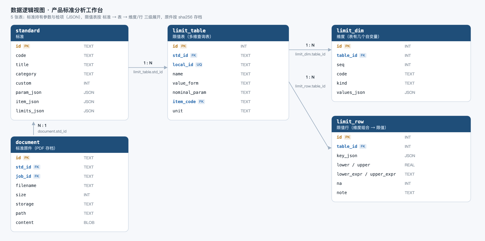
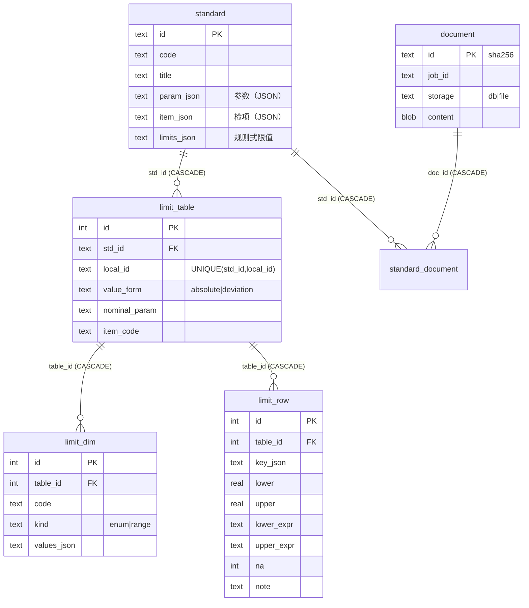

# 数据结构

数据库：SQLite，单文件 `data/app.db`。6 张表，全部逻辑关系由外键 + 级联删除表达。



---
## 1. 表清单

| 表 | 作用 | 与谁相关 | 典型行数（GB/T 3103.3） |
|---|---|---|---|
| `standard` | 标准本身 + 规格参数 + 检项 | 根 | 1 |
| `limit_table` | 一张多维限值表的表头 | N:1 `standard` | 8 |
| `limit_dim` | 表的一个自变量（维度） | N:1 `limit_table` | 18 |
| `limit_row` | 维度组合 → 限值 | N:1 `limit_table` | 143 |
| `document` | 标准原件（PDF） | — | 1 |
| `standard_document` | 标准 ↔ 原件（多对多） | 两边都 N:1 | 1 |

---

## 2. standard（标准）

| 字段 | 类型 | 约束 | 说明 |
|---|---|---|---|
| `id` | TEXT | **PK** | 标准标识，如 `gb3103-3`、`custom-7935d58e` |
| `code` | TEXT | NOT NULL | 标准号，如 `GB/T 3103.3—2000` |
| `title` | TEXT | NOT NULL | 标准名称 |
| `category` | TEXT | | 分类路径，如 `机械 / 紧固件产品 / 垫圈` |
| `scope` | TEXT | | 适用范围说明 |
| `note` | TEXT | | 备注（如"公差适用于镀前尺寸"） |
| `custom` | INTEGER | | 1 = 由上传分析发布的标准 |
| `source_json` | TEXT | | 来源（作业 id、文件名、页数） |
| `param_json` | TEXT(JSON) | | **规格参数数组**，决定第二步表单 |
| `item_json` | TEXT(JSON) | | **检项数组**，每项绑定一张限值表 |
| `limits_json` | TEXT(JSON) | | 规则式限值（上传发布的标准用） |
| `created_at` | REAL | | 创建时间戳 |

`param_json` 元素：

```json
{"code":"h_nom","name":"公称厚度 h","type":"number","unit":"mm",
 "required":true,"min":0.1,"max":20,"default":2.0,
 "options":[],"help":"决定 d₁、d₂、Δh、t₂ 的分档"}
```

`item_json` 元素：

```json
{"id":"d1","name":"通孔直径","symbol":"d₁","clause":"3.1",
 "table":"T-D1","kind":"尺寸","requires":[],
 "nominal_param":"d1_nom","measured_key":"d1_act",
 "method":"塞规通止；计量用内径千分尺","position":"孔壁圆柱直段",
 "gauge":"塞规、内径千分尺(0.01)","points":"2 个方向"}
```

`limits_json`（仅规则式）：

```json
{"x":{"mode":"rule","unit":"mm","rules":[
   {"if":"h_nom<=4 and d_nom<=18","lower":"d_nom","upper":"d_nom+0.27"},
   {"if":"grade==\"C\"","na":true}]}}
```

---

## 3. limit_table（限值表）

| 字段 | 类型 | 约束 | 说明 |
|---|---|---|---|
| `id` | INTEGER | **PK** | 代理键（供子表引用） |
| `std_id` | TEXT | **FK** → `standard.id` `ON DELETE CASCADE` | 所属标准 |
| `local_id` | TEXT | NOT NULL，`UNIQUE(std_id, local_id)` | **标准内**的表 id，如 `T-D1` |
| `name` | TEXT | | 表名 |
| `unit` | TEXT | | 单位，默认 `mm` |
| `value_form` | TEXT | | `absolute` 绝对值 / `deviation` 偏差 |
| `nominal_param` | TEXT | | 偏差型叠加哪个参数，如 `d1_nom` |
| `item_code` | TEXT | **FK**(逻辑) → `item_json[].id` | 服务哪个检项 |
| `sort` | INTEGER | | 排序 |

**为什么要两个 id**：`local_id` 是业务上的表号（界面、导入导出、深链都用它），
`id` 只是代理键。约束 `UNIQUE(std_id, local_id)` 保证两个标准可各有 `T-D1`、互不干扰。

索引：`idx_lt_std(std_id)`、唯一索引 `(std_id, local_id)`。

---

## 4. limit_dim（维度）

| 字段 | 类型 | 约束 | 说明 |
|---|---|---|---|
| `id` | INTEGER | **PK** | |
| `table_id` | INTEGER | **FK** → `limit_table.id` `ON DELETE CASCADE` | |
| `seq` | INTEGER | | 维度顺序（决定列顺序） |
| `code` | TEXT | | 参数 code，必须存在于 `param_json`，如 `h_nom` |
| `kind` | TEXT | | `enum` 枚举 / `range` 区间 |
| `values_json` | TEXT(JSON) | | 该维度的取值 |

```json
["A","C"]                        // enum
[[0,4],[4,20],[10,20]]           // range，左开右闭
```

---

## 5. limit_row（限值行）

| 字段 | 类型 | 约束 | 说明 |
|---|---|---|---|
| `id` | INTEGER | **PK** | |
| `table_id` | INTEGER | **FK** → `limit_table.id` `ON DELETE CASCADE` | |
| `key_json` | TEXT(JSON) | | 维度取值组合 |
| `lower` / `upper` | REAL | | 数值型限值 |
| `lower_expr` / `upper_expr` | TEXT | | 表达式型，**优先于数值** |
| `na` | INTEGER | | 1 = 标准明确"不要求" |
| `note` | TEXT | | 备注，如 `H13 @ (10,18]`，会出现在解析轨迹里 |

```json
{"grade":"A","h_nom":[0,4],"d1_nom":[10,18]}   // key_json
```

索引：`idx_lr_tbl(table_id)`。

---

## 5.1 document（原件）+ standard_document（关联）

| 字段 | 类型 | 约束 | 说明 |
|---|---|---|---|
| `id` | TEXT | **PK** | **sha256**，内容寻址，天然去重 |
| `job_id` | TEXT | | 来自哪次上传 |
| `filename` | TEXT | | 原始文件名 |
| `mime` | TEXT | | 默认 `application/pdf` |
| `size` | INTEGER | | 字节数 |
| `storage` | TEXT | | `db` = 内容在库里；`file` = 只存路径（>20MB） |
| `path` | TEXT | | `storage=file` 时有效 |
| `content` | BLOB | | PDF 原文（≤20MB） |
| `created_at` | REAL | | |

**阈值**：20MB。以下进库，以上只留路径 —— 小文件跟着库走，大文件不撑爆备份。

**去重**：id 就是 sha256，同一份文件重复上传只会有一行，且直接复用已有作业，不重复 OCR。

**生命周期**：上传后只是一个"文档"，挂到哪个标准由 `standard_document` 决定。
一份原件可以挂多个标准（同族标准共用一份附录）；删标准只删关联，原件保留。

原件入库后，磁盘上的临时副本会在分析结束时删掉。

---

## 6. 关系



- 删 `standard` → 级联删它的 `limit_table`（连带维度/行）与 `standard_document` 关联；
  **原件本身保留**，还能挂到别的标准上。
- `canonical` 的引用方向只有一条：**标准 → 表 → 维度/行**。检项通过 `item_json[].table` 指向 `local_id`。

---

## 7. 完整 DDL

```sql
PRAGMA foreign_keys = ON;

CREATE TABLE standard (
    id            TEXT PRIMARY KEY,
    code          TEXT NOT NULL,
    title         TEXT NOT NULL,
    category      TEXT DEFAULT '',
    scope         TEXT DEFAULT '',
    note          TEXT DEFAULT '',
    custom        INTEGER DEFAULT 0,
    source_json   TEXT DEFAULT '{}',
    param_json    TEXT DEFAULT '[]',
    item_json     TEXT DEFAULT '[]',
    limits_json   TEXT DEFAULT '{}',
    created_at    REAL
);

CREATE TABLE limit_table (
    id            INTEGER PRIMARY KEY AUTOINCREMENT,
    std_id        TEXT NOT NULL REFERENCES standard(id) ON DELETE CASCADE,
    local_id      TEXT NOT NULL,
    name          TEXT,
    unit          TEXT DEFAULT 'mm',
    value_form    TEXT DEFAULT 'absolute',
    nominal_param TEXT,
    item_code     TEXT,
    sort          INTEGER DEFAULT 0,
    UNIQUE (std_id, local_id)
);

CREATE TABLE limit_dim (
    id            INTEGER PRIMARY KEY AUTOINCREMENT,
    table_id      INTEGER REFERENCES limit_table(id) ON DELETE CASCADE,
    seq           INTEGER,
    code          TEXT,
    kind          TEXT,
    values_json   TEXT DEFAULT '[]'
);

CREATE TABLE limit_row (
    id            INTEGER PRIMARY KEY AUTOINCREMENT,
    table_id      INTEGER REFERENCES limit_table(id) ON DELETE CASCADE,
    key_json      TEXT,
    lower         REAL,
    upper         REAL,
    lower_expr    TEXT,
    upper_expr    TEXT,
    na            INTEGER DEFAULT 0,
    note          TEXT
);

CREATE TABLE document (
    id            TEXT PRIMARY KEY,          -- sha256
    job_id        TEXT,
    filename      TEXT,
    mime          TEXT DEFAULT 'application/pdf',
    size          INTEGER,
    storage       TEXT DEFAULT 'db',         -- db | file
    path          TEXT,
    content       BLOB,
    created_at    REAL
);

CREATE TABLE standard_document (
    std_id     TEXT NOT NULL REFERENCES standard(id) ON DELETE CASCADE,
    doc_id     TEXT NOT NULL REFERENCES document(id) ON DELETE CASCADE,
    created_at REAL,
    PRIMARY KEY (std_id, doc_id)
);

CREATE INDEX idx_sd_doc ON standard_document(doc_id);
CREATE INDEX idx_doc_job ON document(job_id);
CREATE INDEX idx_lt_std ON limit_table(std_id);
CREATE INDEX idx_lr_tbl ON limit_row(table_id);
```

---

## 8. 一个真实例子

GB/T 3103.3 的通孔表，落到库里是这样：

```
standard          gb3103-3 / GB/T 3103.3—2000
  param_json      [grade, material, h_nom, d1_nom, d2_nom]
  item_json       [{id:"d1", table:"T-D1", measured_key:"d1_act", ...}, ...]

limit_table       id=1  std_id=gb3103-3  local_id=T-D1
                  value_form=deviation  nominal_param=d1_nom  item_code=d1

limit_dim         seq=0 grade   enum  ["A","C"]
                  seq=1 h_nom   range [[0,4],[4,20]]
                  seq=2 d1_nom  range [[0,3],[3,6],...,[180,250]]

limit_row         key={"grade":"A","h_nom":[10,18],"d1_nom":[10,18]}
                  lower=0.0  upper=0.27  note="H13 @ (10, 18]"
```

求值：`d1_nom=13, h_nom=2, grade=A` → 命中该行 → 偏差 0/+0.27
→ `value_form=deviation` 叠加公称 13 → **13.000 ～ 13.270 mm**。

---

## 9. 导出

`tools/export_standard.py <std_id> [out.xlsx]` 把上述 6 张表的内容导成一个工作簿：
概况 / 参数 / 检项 / 限值表 / 维度 / 限值行，JSON 字段全部展开成可读表格。

## 10. 其它持久化数据（不在库里）

| 路径 | 内容 | 说明 |
|---|---|---|
| `data/uploads/` | 大文件（>20MB）的原件 | 小文件已进 `document` 表；临时副本分析后清理 |
| `data/jobs/<job>.json` | 分析作业状态、OCR 文本、候选检项、表格网格 | 作业是文件，不是表 |
| `data/app.db` | 上述 4 张表 | 删库会丢数据，但 `run.sh` 会重灌样例 |

作业之所以没进表：它是一次性中间产物，生命周期短、结构随解析逻辑变，用 JSON 更省事。
如果以后要多人协作、要审计，再把 `job` 提到表里。
