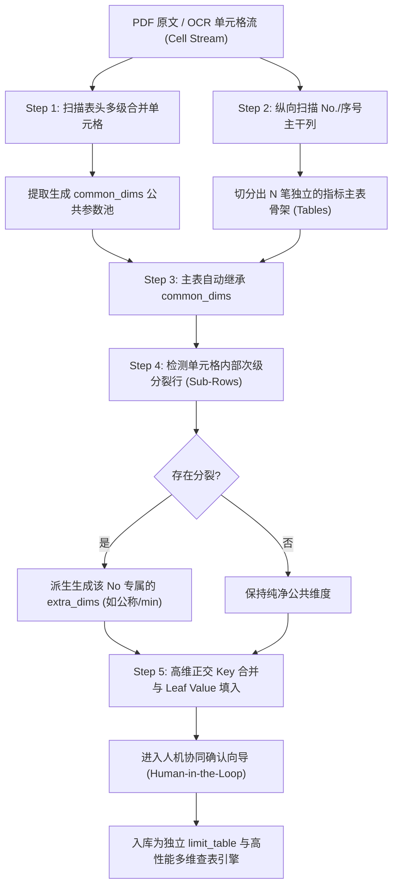

# 国家/行业标准复合大表通用提取与多维切分架构规范
(Universal Standard Matrix Extraction & Limit Compilation Architecture)

---

## 一、 现实痛点与业务本质

国家标准（GB/T）和行业标准（如 GB/T 3098.1、GB/T 3098.2、GB/T 3103.3 等）中，力学性能、保证载荷、公差配合等核心数据大量以**“复合大表（Matrix Table）”**形式呈现。

传统程序在面对这类表格时极易陷入两类极端错误：
1. **生搬硬套二维平铺表**：将整张大表横向列全部展开，导致指标多、维度杂，若某个指标需要增加参数（如抗拉强度内部细分公称/min），整个平铺结构瞬间崩溃，无法独立增维；
2. **针对单表硬编码**：为“表3”、“表4”各写一套死板逻辑，换一张新国标（如螺母保载表、高温拉伸表）就必须推倒重来。

### 核心本质洞察：
**国标复合大表在拓扑学上绝非单纯的“平面表格”，而是一个以“表头公共参数”为树根、以“No. 序号指标”为主干、以“内部次级参数”为枝叶的多维决策树集群。**

---

## 二、 拓扑三层解构模型 (3-Layer Topology Model)

无论标准表格的排版形式如何演变，其数学与工程本质均严格遵循以下三层拓扑：

```
                    ┌──────────────────────────────────────────────┐
                    │      Layer 1: 表头公共参数池 (Common Dims)      │
                    │   例如：性能等级 (property_class) × 直径 (d_nom) │
                    └──────────────────────┬───────────────────────┘
                                           │ (默认全量自动继承)
             ┌─────────────────────────────┼─────────────────────────────┐
             ▼                             ▼                             ▼
  ┌──────────────────────┐      ┌──────────────────────┐      ┌──────────────────────┐
  │ Layer 2: No. 1 主表  │      │ Layer 2: No. 2 主表  │      │ Layer 2: No. 5 主表  │
  │ 抗拉强度 Rm (MPa)    │      │ 下屈服强度 ReL (MPa) │      │ 保证应力 Sp (MPa)    │
  └──────────┬───────────┘      └──────────┬───────────┘      └──────────┬───────────┘
             │ (人机协同确认)              │                             │
             ▼                             ▼                             ▼
  ┌──────────────────────┐      ┌──────────────────────┐      ┌──────────────────────┐
  │ Layer 3: 专属增量参数│      │ Layer 3: 专属增量参数│      │ Layer 3: 专属增量参数│
  │ ➕ 公称抗拉 rm_nom   │      │ (无额外参数，保持2维)│      │ ➕ 保证应力公称 sp_nom│
  └──────────┬───────────┘      └──────────┬───────────┘      └──────────┬───────────┘
             │                             │                             │
             ▼                             ▼                             ▼
  ┌──────────────────────┐      ┌──────────────────────┐      ┌──────────────────────┐
  │ 最终独立限值表 (3维) │      │ 最终独立限值表 (2维) │      │ 最终独立限值表 (3维) │
  │ T-PROP-RM (830加严)  │      │ T-PROP-REL           │      │ T-PROP-SP            │
  └──────────────────────┘      └──────────────────────┘      └──────────────────────┘
```

### 1. 第一层：表头公共参数池 (Global Header Context / Dimension Pool)
- **视觉特征**：横跨表格最上方的复合表头，具有多级表头合并单元格特征。
- **语义角色**：整张母表所有指标的基础输入自变量。
- **典型代表**：`性能等级 (property_class)`、`公称直径 (d_nom)`、`材料/牌号 (material)`、`产品规格 (spec)`。

### 2. 第二层：按 No. 序号展开的独立限值主表 (Item / Indicator Entity)
- **视觉特征**：表格最左侧的纵向主干列，通常由 `No.`、`序号`、`项目`、`检验项目` 标明。
- **语义角色**：**每一个 No. 是一个具备独立物理含义的检验项（Check Item）与限值主表实体（Limit Table Entity）**，具有专属的单位（如 MPa、N、HV、%）、条款依据与判定标准。

### 3. 第三层：指标内部专属增量参数树 (Indicator-Scoped Extra Dimensions)
- **视觉特征**：某个 No. 行内部嵌套的横向细分次级行（Sub-rows）或次级列。
- **语义角色**：该指标专属的增量自变量。
  - *例 1*：No. 1 抗拉强度细分为“公称”与“min”，意味着该项派生了第 3 维度 `rm_nom`（公称抗拉强度）；
  - *例 2*：高温性能表细分为“20℃”、“100℃”、“300℃”，派生了专属维度 `test_temp`（试验温度）；
  - *例 3*：冲击吸收能量细分为“V型缺口”、“U型缺口”，派生了专属维度 `notch_type`（缺口类型）。
- **数学本质**：
  $$\text{指标总维度空间 } \mathcal{D}_{\text{ind}} = \mathcal{D}_{\text{common}} \otimes \mathcal{D}_{\text{extra}}$$

---

## 三、 通用数据契约协议 (Universal Standard Matrix Protocol - USMP)

基于上述抽象模型，无论前端向导、OCR 自动抽取、LLM 结构化提取还是关系数据库存储，均统一遵循以下标准 JSON 契约：

```json
{
  "$schema": "https://schema.standard-analyze.org/v1/matrix.json",
  "local_id": "M-PROP-TABLE3",
  "title": "GB/T 3098.1 表3 螺栓机械和物理性能",
  "category": "性能",
  
  "common_dims": [
    {
      "code": "property_class",
      "name": "性能等级",
      "kind": "enum",
      "options": ["4.6", "4.8", "5.6", "5.8", "6.8", "8.8", "9.8", "10.9", "12.9"]
    },
    {
      "code": "d_nom",
      "name": "公称直径 d",
      "kind": "range",
      "unit": "mm"
    }
  ],
  
  "tables": [
    {
      "no": "1",
      "name": "抗拉强度 Rm",
      "unit": "MPa",
      "local_table_id": "T-PROP-RM",
      "item_id": "it-rm",
      "clause": "9.1",
      
      "extra_dims": [
        {
          "code": "rm_nom",
          "name": "公称抗拉强度 Rm,nom",
          "kind": "enum",
          "source": "sub_row_header"
        }
      ],
      
      "rows": [
        {
          "key": { "property_class": "8.8", "d_nom": [0, 16], "rm_nom": "800" },
          "nominal": 800.0,
          "lower": 800.0,
          "upper": 1000.0,
          "note": ""
        },
        {
          "key": { "property_class": "8.8", "d_nom": [16, 39], "rm_nom": "800" },
          "nominal": 800.0,
          "lower": 830.0,
          "upper": 1030.0,
          "note": "大规格加严"
        }
      ]
    },
    {
      "no": "2",
      "name": "下屈服强度 ReL",
      "unit": "MPa",
      "local_table_id": "T-PROP-REL",
      "item_id": "it-rel",
      "clause": "9.2",
      "extra_dims": [],
      "rows": [
        {
          "key": { "property_class": "4.6", "d_nom": [0, 39] },
          "nominal": 240.0,
          "lower": 240.0,
          "upper": null
        }
      ]
    }
  ]
}
```

---

## 四、 自动化通用提取管道 (Universal Extraction Pipeline)

该抽象不仅用于人工向导，更为后续实现 **“AI / OCR 自动识别任意国标复合大表”** 提供了标准的五步算法流水线：



### 关键自动化规则：
1. **表头公共参数抽取规则**：
   - 当某一行/列连续覆盖所有检项主干行，且包含参数型关键字（如“等级”、“直径”、“厚度”、“规格”、“状态”），判定为公共自变量池 `common_dims`；
2. **No 序号切分规则**：
   - 寻找视觉最左侧序号列中的 `\b(No\.?|[0-9]{1,2}|[a-z])\b` 作为指标切分锚点，每个锚点实例化为一个 `Table` 对象；
3. **内部次级增量参数判定规则**：
   - 若锚点对应的检项单元格在右侧跨越了多行小文本（如“公称”/“min”、“纵向”/“横向”、“心部”/“表面”），则自动提取为该指标专属的增量参数 `extra_dims`，避免污染全局表头；
4. **叶子节点数值归一化 (Leaf Cell Normalization)**：
   - 支持解析：双值表达式（`400 / ≥420` $\rightarrow$ nominal: 400, lower: 420）、区间值（`250~320`）、单边不等式（`≥800`）、排除符（`—` / `/` $\rightarrow$ na: true）。

---

## 五、 架构收益与公用价值

1. **业务解耦性**：
   母表是大脑（总览视图），子表是神经末梢（精准判定）。保存母表时一键切分，判定出卡时直接通过子表毫秒级寻址，互不干扰；
2. **无限扩展性**：
   未来遇到任意层级的复合表格（无论增加温度、标尺、状态、热处理），只需在对应 No. 上挂接 `extra_dims`，系统底层引擎无需做任何破坏性修改；
3. **标准化与复用度 100%**：
   不管是紧固件、金属材料、管件、电子元器件的标准规范，只要遵循 USMP 协议，均可直接复用同一套交互向导、数据编译与出卡引擎。
