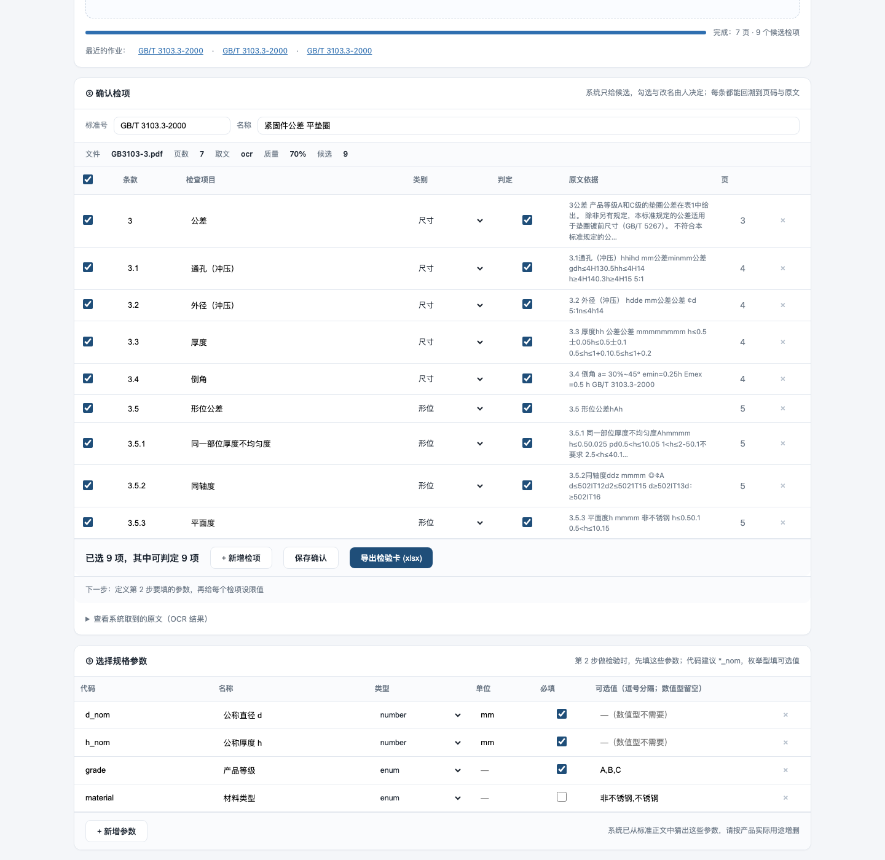
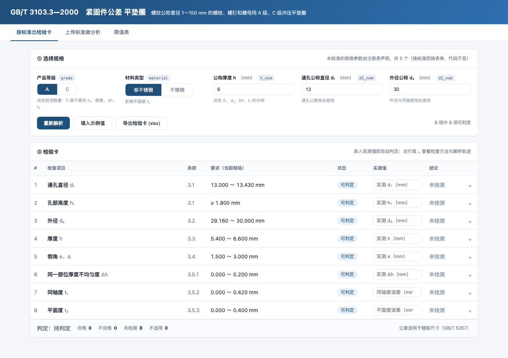
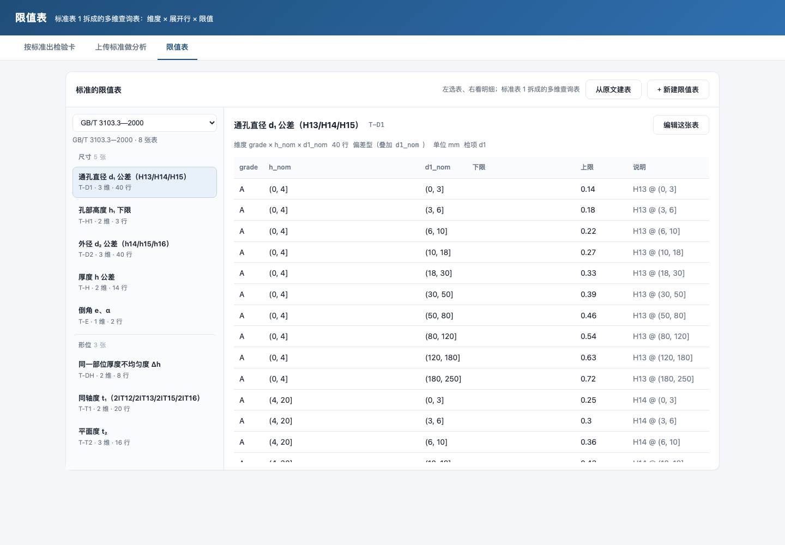
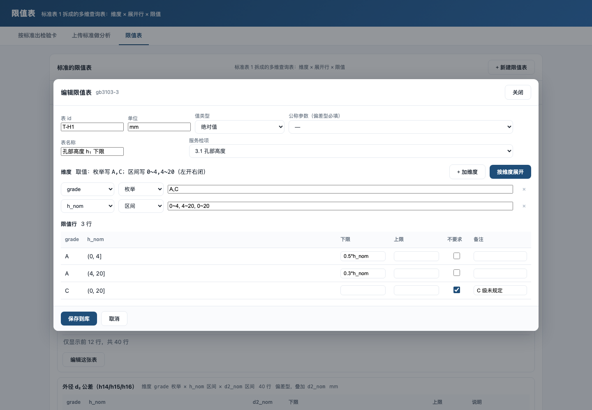
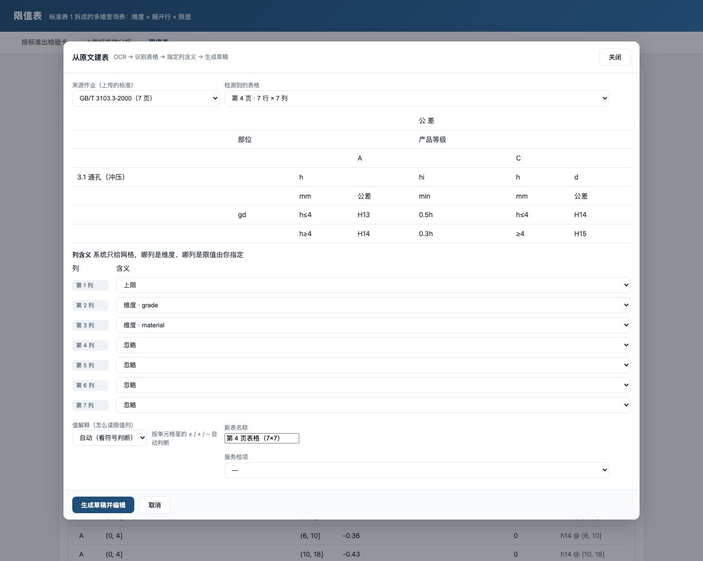

# 产品标准检验卡服务

两个人、两个页签，一条链路：

| | 谁用 | 做什么 | 产出 |
|---|---|---|---|
| **上传标准做分析** | 标准分析员 | 上传 PDF → 确认检项 → 定义参数 → 设限值 | **发布成一个标准** |
| **按标准出检验卡** | 检验员 | 选标准 → 填规格 → 得检验卡 → 填实测 → 判定 | 检验记录 + xlsx |

第一步的产物不是一份文档，而是**系统里的一个标准**：它有参数 schema（第二步的弹窗表单）、
检项清单、每个检项的限值。发布后立刻出现在第二步的标准下拉里。





## 快速启动

```bash
python3 -m venv .venv                      # 用 python.org 的 3.12，原因见文末
.venv/bin/pip install -r g1/service/requirements.txt
./g1/service/run.sh                        # 默认 8022
```

浏览器打开 <http://127.0.0.1:8022>：

- `#/card` —— 按标准出检验卡（`?demo=1` 带示例实测值）
- `#/analyze` —— 上传标准做分析

## 第一步：上传标准做分析

```
PDF ──OCR──► 文本 ──条款切分──► 候选检项 ──人工确认──► 定义参数 ──► 设限值 ──► 发布
      (本地)                  (规则)            (勾选/改名)   (③)        (④)
```

1. **取文**：用 macOS Vision 做离线中文 OCR，不联网、不上传。
   扫描件和"文字层是乱码"的老标准都能读（这份 GB/T 3103.3 的文字层就是乱的）。
2. **识别**：按条款号（`3.1`、`3.5.2`）切分，取条款标题作为检项名，
   再按关键词归到 尺寸 / 形位 / 性能 / 表面 / 标记 五类。
3. **确认**：系统只给候选。界面上逐条勾选、改名、调类别、补检查方法、删掉不要的，
   每条都能展开看页码与原文依据。
4. **③ 定义参数**：系统从正文里猜出规格参数（公称直径、厚度、等级、材料…），
   可增删改；参数代码就是第二步表单的字段名（`d_nom`、`h_nom`）。
5. **④ 设限值**：逐项选判定方式 —— 上下限可以填**数字**、**表达式**，或选**规则**按参数分档。
6. **发布**：把「参数 + 检项 + 限值」存成一个标准，第二步立刻可用。

7 页扫描件全流程约 5 秒；100 页的标准建议先在本地试跑一次再上生产。

### 限值分三档，越往下越"随参数变"

| 写法 | 例子 | 适用 |
|---|---|---|
| 常量 | 下限 `13.00` 上限 `13.27` | 同一规格反复检验 |
| 表达式 | 下限 `0.25*h_nom` 上限 `0.5*h_nom` | 限值是参数的函数（倒角、孔高） |
| 规则 | `h_nom<=4 and d_nom<=18 => d_nom ~ d_nom+0.27` | 按参数分档（公差带、平面度、同轴度） |

规则一行一条，`条件 => 下限 ~ 上限`，最后一行写 `else` 兜底；
`条件 => 不要求` 表示该情形下标准不要求（如 C 级不要求平面度）。
条件支持 `<= >= < > == !=`、`and or not`、括号，变量就是③里定义的参数。

**只有常量限值时，改参数不会改限值**——这不是 bug，是录入方式和标准结构不匹配。
真标准的限值几乎都随规格变，所以④里大多数项应该用表达式或规则。

**示例**：`tools/seed_gb3103.py` 把 GB/T 3103.3 表 1 整张录成了规则（限值由符号表生成，不手抄），
发布成 `custom-gb3103`。选中它，填 d₁=18、d₂=30、h=6、A 级：

```
通孔  18.000 ～ 18.430   （h>4 → H14，18 在 10~18 档 → +0.43）
外径  29.160 ～ 30.000   （h>4 → h15，-0.84）
厚度   5.400 ～ 6.600    （4<h≤6 → ±0.6）
倒角   1.500 ～ 3.000    （0.25h ～ 0.5h）
```

改成 C 级，倒角/Δh/平面度立刻变成"不要求"。

### 限值由人填，不由 OCR 猜

系统只识别"有哪些检项"，**不解析限值表**（多维、合并单元格、代号与公式混排）。
硬把表格数值 OCR 出来当限值，错误率会高到不可用——OCR 把 `≤` 认成 `≥`、小数点丢失都是常态。

所以④里的限值是**常量**：一个检项一组上下限。这覆盖了"同一规格重复检验"的绝大多数场景。
真正随规格变化的限值（H13 随公称直径变化、2IT12 随 d₂ 分档），走已建模的 GB/T 3103.3
那条路径——它用符号表 + 表达式引擎算，而不是存死数。

## 数据层：四张表 + 多维限值表

`data/app.db`（SQLite），表结构对应系统的四步：

| 表 | 作用 | GB/T 3103.3 里的量 |
|---|---|---|
| `standard` | 标准本身 + 规格参数 + 检项 + 规则式限值 | 1 条标准，5 个参数，8 个检项 |
| `limit_table` | 一张多维限值表的表头 | 8 张（T-D1/T-D2/T-H/T-H1/T-E/T-DH/T-T1/T-T2） |
| `limit_dim` | 这张表有哪几维 | 18 个维度（如 grade × h_nom × d1_nom） |
| `limit_row` | 维度取值组合 → 限值 | 143 行 |

限值表**属于标准，表 id 只在标准内唯一**：

```sql
limit_table(id INTEGER PK, std_id, local_id, ...)   UNIQUE(std_id, local_id)
```

两个标准可以各有一张 `T-D1`，互不干扰；删标准只级联删自己的表。
（旧库的 `id` 是全局主键，已被自动迁移；跨标准**共享**暂不支持。）

`limit_row` 的值有两种写法：数值 `lower/upper`，或表达式 `lower_expr/upper_expr`。
表头 `value_form` 区分两类：

- **absolute**：值就是绝对量（Δh ≤0.2、t₂ ≤0.4）
- **deviation**：值是偏差，判定时叠加 `nominal_param`（通孔给 0/+0.27，叠加 d₁=18 得 18.00～18.27）

**为什么 d₁ 的表是"偏差型"而不是"绝对型"**——限值随公称直径连续变化，
不可能把 1～150 mm 每个值都列成行。存偏差、按公称叠加，才是这个标准真正的结构。

三层维度用左开右闭区间 `(from, to]`，"h≤4 / h>4"和"18 落在 (10,18] 档"都靠它区分。



界面第三个页签「限值表」是左右两栏：**左选表、右看明细**。
左列按检项的类别分组（尺寸 / 形位 / 性能 / 表面 / 标记 / 其他），组内按条款顺序列出表
（名称 + 表 id + 维数 + 行数），点一下右栏就换成那张表的维度、
值类型、全部限值行；右栏右上角「编辑这张表」直接进编辑器。深链 `#/tables/T-T2` 可定位到具体表。



录入流程就四步：

1. **选维度**：从该标准的参数里挑（最多几个都行），每维选「枚举」或「区间」；
2. **写取值**：枚举写 `A,C`，区间写 `0~4,4~20`（左开右闭）；
3. **按维度展开**：系统做笛卡尔积，生成 N 行空限值（已有行按 key 保留，不会丢）；
4. **逐行填**：下限/上限可以填数字，也可以填表达式（`0.5*h_nom`）；
   勾「不要求」表示该情形标准不豁免；备注里写代号（`H13 @ (10,18]`），判定时轨迹会带出来。

保存即落库，**立刻生效**——第二步刷新就按新表算。测试里有一条专门盯这个：
把 h₁ 的下限从 `0.5*h_nom` 改成 `0.6*h_nom`，d₁=13/h=2 的卡从 `≥1.000` 变成 `≥1.200`，改回又复原。

## 从原文自动建表



限值表可以不从空白开始：**「限值表」页签 → 从原文建表**。

```
PDF ──OCR（带坐标）──► 词 + 外接框 ──聚行找列──► 网格 ──指定列含义──► 草稿表 ──人核对──► 入库
```

1. **OCR 带坐标**：`ocrkit` 现在输出每个词的 `x/y/w/h`（300 dpi）。
2. **还原网格**：按 y 聚行；在行内投影 x，找"贯穿的空白"作为列分隔；把词落进格子拼文本。
3. **指定列含义**：系统只给网格，哪列是维度、哪列是下限/上限**由人指定**（会给个初始猜测）。
4. **值解释**：限值列的读法可选 —— 自动 / `±x` 对称 / `+x` 上偏差 / `−x` 下偏差 /
   单值作上限或下限 / `a~b` 区间。自动模式会认 `±`、`士`（OCR 常把这俩搞混）、`+`、`−`、`~`，
   而 `H13`、`IT12` 这类代号不会被误当成数字。
5. **生成草稿**：维度列的去重取值 → 维度；每行按值解释算出 lower/upper，原文串进备注。
6. **进编辑器**：草稿直接打开在录入界面里，核对、修正、再存库。

识别效果（GB/T 3103.3 第 5 页）——能稳定还原"分档 → 数值"这类两列表：

| h_nom | 限值 |
|---|---|
| h≤0.5 | 0.1 |
| 0.5<h≤1 | 0.15 |
| 1<h≤2.5 | 0.2 |

合并单元格、跨行表头、多行折行的格子会被切碎（比如"h≤0.5 ±0.05"挤在一格），
这是 OCR 的先天限制，**所以定位是"草稿"而不是"成品"**：机器铺好 80% 的骨架，人只改剩下的。

## 每个标准的参数个数不一样，怎么处理

**参数不是写死在服务里的，是标准自己声明的。** 一个标准长这样：

```python
Standard(
    id="gb3103-3", code="GB/T 3103.3—2000", title="紧固件公差  平垫圈",
    params=[                                  # ← 界面表单就是按它渲染的
        Param("grade", "产品等级", "enum", options=["A", "C"], default="A"),
        Param("h_nom", "公称厚度 h", "number", "mm", required=True, minimum=0.1, maximum=20),
        Param("d1_nom", "通孔公称直径 d₁", "number", "mm", required=False, minimum=1, maximum=150),
    ],
    items=[...],      # 每个检项声明 requires=["d1_nom"]、measured_key="d1_act"
    tables={...},     # 维度名与参数 code 对齐
    symbols={...},
)
```

| 变化 | 系统自动处理 |
|---|---|
| 参数 3 个 / 7 个 / 12 个 | 表单按 `params` 渲染，多一个参数就多一个字段 |
| 枚举 vs 数值 | `type=enum` 渲染分段/下拉；`number` 渲染带 min/max 的数字框 |
| 哪些必填 | `required`；缺失即 422 并说明缺谁 |
| 本检项要哪些参数 | 检项 `requires`；缺则该项降级为「无法判定」，不影响其他项 |

**不做隐式默认填充。** 默认值只用于表单预填；接口缺必填参数直接 422，不替调用方猜
——检验服务里静默补一个 h 值，等于悄悄换了一套限值。

## 命名约定

| 后缀 | 含义 | 谁能用 |
|---|---|---|
| `*_nom` | 公称尺寸，如 `d1_nom` = 13 | 唯一允许用于查表分档、算极限 |
| `*_act` | 实际尺寸，如 `d1_act` = 13.12 | 只用于与极限比较，禁止进入查表 |

查表若误用实测值，18.01 会从 `(10,18]` 档跳到 `(18,30]` 档，H13 由 0.27 变成 0.33，
上限松动 0.07 mm，**而且不报错**。

## 接口

| 方法 | 路径 | 说明 |
|---|---|---|
| GET | `/` | 单页界面（两个视图） |
| GET | `/api/standards` | 已建模标准列表 |
| GET | `/api/meta?std=` | 参数 schema、检项清单 |
| POST | `/api/resolve` | `{std, params}` → 限值（含 trace） |
| POST | `/api/judge` | `{std, params, measured}` → 判定 |
| GET | `/api/card.xlsx?std=&<参数>` | 导出已建模标准的检验卡 |
| POST | `/api/analyze/upload` | 上传 PDF，返回 `job_id`（异步分析） |
| POST | `/api/analyze/text` | 直接分析粘贴的文本 |
| GET | `/api/analyze/jobs` | 作业列表 |
| GET | `/api/analyze/jobs/{id}` | 作业状态与候选检项 |
| PUT | `/api/analyze/jobs/{id}/items` | 保存人工确认后的检项 |
| GET | `/api/analyze/jobs/{id}/text` | OCR 原文 |
| GET | `/api/analyze/jobs/{id}/card.xlsx` | 导出检验卡（草稿） |
| POST | `/api/standards/publish` | 把作业发布成标准 |
| POST | `/api/standards/unpublish/{id}` | 下架自定义标准 |
| DELETE | `/api/analyze/jobs/{id}` | 删除作业 |

### 示例：上传并轮询

```bash
JOB=$(curl -s -F "file=@GB3103-3.pdf" http://127.0.0.1:8022/api/analyze/upload \
      | python3 -c "import json,sys;print(json.load(sys.stdin)['job_id'])")
curl -s http://127.0.0.1:8022/api/analyze/jobs/$JOB | python3 -m json.tool | head -30

# 发布成标准（items / params / limits 来自作业，可先 PUT 修改）
curl -s -X POST http://127.0.0.1:8022/api/standards/publish \
  -H 'Content-Type: application/json' \
  -d '{"job_id":"'$JOB'","code":"GB/T 3103.3-2000","title":"紧固件公差 平垫圈",
       "params":[...],"items":[...],"limits":{"c002":{"mode":"range","lower":13.0,"upper":13.27}}}'

# 第二步：按这个标准出卡
curl -s -X POST http://127.0.0.1:8022/api/resolve \
  -H 'Content-Type: application/json' \
  -d '{"std":"custom-xxx","params":{"d_nom":13,"h_nom":2,"grade":"A"}}'
```

```json
{"status":"done","pages":7,"engine":"ocr","quality":0.699,
 "code":"GB/T 3103.3-2000","title":"紧固件公差 平垫圈",
 "items":[{"clause":"3.1","title":"通孔（冲压）","category":"尺寸","page":4,
           "evidence":"3.1通孔（冲压）h≤4H130.5h","selected":true}]}
```

## 测试

```bash
.venv/bin/python g1/gb3103_3.py               # 28 项  引擎层，不需要服务
.venv/bin/python g1/service/test_api.py       # 42 项  HTTP 层（编辑往返 + 标准隔离）
.venv/bin/python g1/service/test_generic.py   # 22 项  通用性：换个 7 参数标准不改代码
.venv/bin/python g1/service/test_limits.py    # 12 项  常量/公式/规则/不要求/未命中/表达式安全
.venv/bin/python g1/service/test_parse.py     # 15 项  限值单元格解析（±/士/+/~/代号）
.venv/bin/python g1/service/tools/load_gb3103.py   # 把标准灌进 SQLite（8 表 143 行）
.venv/bin/python g1/service/test_analyze.py   # 39 项  上传→OCR→识别→表格检测→确认→发布→出卡判定
```

## 代码结构

```
g1/
  limit_engine.py        解析引擎（四类值 / 三态 / 偏差与绝对值 / 基准参数）
  gb3103_3.py            GB/T 3103.3 的 8 张限值表 + 28 项断言
  service/
    standards.py         标准注册表：Param / Standard / REGISTRY
    items.py             检项元数据：requires、measured_key、方法、量具
    app.py               FastAPI 路由（不含任何具体标准的字段）
    card.py              已建模标准的检验卡 xlsx
    extract_doc.py       PDF → 文本（ocrkit 离线 OCR）
    tablefind.py         从 OCR 词框还原表格网格
    analyze.py           条款切分 + 检项识别（规则）
    jobs.py              分析作业：落盘、线程、状态
    tools/seed_gb3103.py 演示数据：把 GB/T 3103.3 录成规则版标准
    card_std.py          上传标准的检验卡 xlsx
    db.py                SQLite：standard / limit_table / limit_dim / limit_row
    ocr/ocr.swift        OCR 源码（Vision，可用 swiftc 重新编译）
    bin/ocrkit           已编译的 OCR 可执行文件
    templates/index.html 单页界面（两个视图，无构建步骤）
    test_*.py            三层测试
    docs/*.png           界面截图
data/
  app.db                 标准库（SQLite）
  uploads/               上传的 PDF 原件
  jobs/                  作业状态与确认结果（JSON）
```

## 已知限制

- **只支持 PDF**；图片需先转 PDF（macOS 预览可直接导出）。
- **OCR 会看错符号**：`≤` 可能识别成 `≥`，小数点位也可能丢。所以本版不把 OCR 出的数值当限值用。
- **表格页文字会被打散**：多维表格 OCR 后按行拼接，看不出列关系，需人工对照原页确认。
- **识别是规则驱动**，不含语义理解：条款标题不规范的标准（如"检验规则"整章）识别率会下降。
- **不联网、不调大模型**；若后续接入 LLM 增强，只需在 `analyze.py` 的 `parse()` 后加一层重排/补全。

## 为什么不用 DSH 内置解释器

内置 Python 3.12 带 hardened runtime，加载 pip 装的 `pydantic_core` 这类非系统签名扩展会报
`different Team IDs` 而失败（`codesign` 重签也无效）。环境建在 python.org 的 3.12 上。
